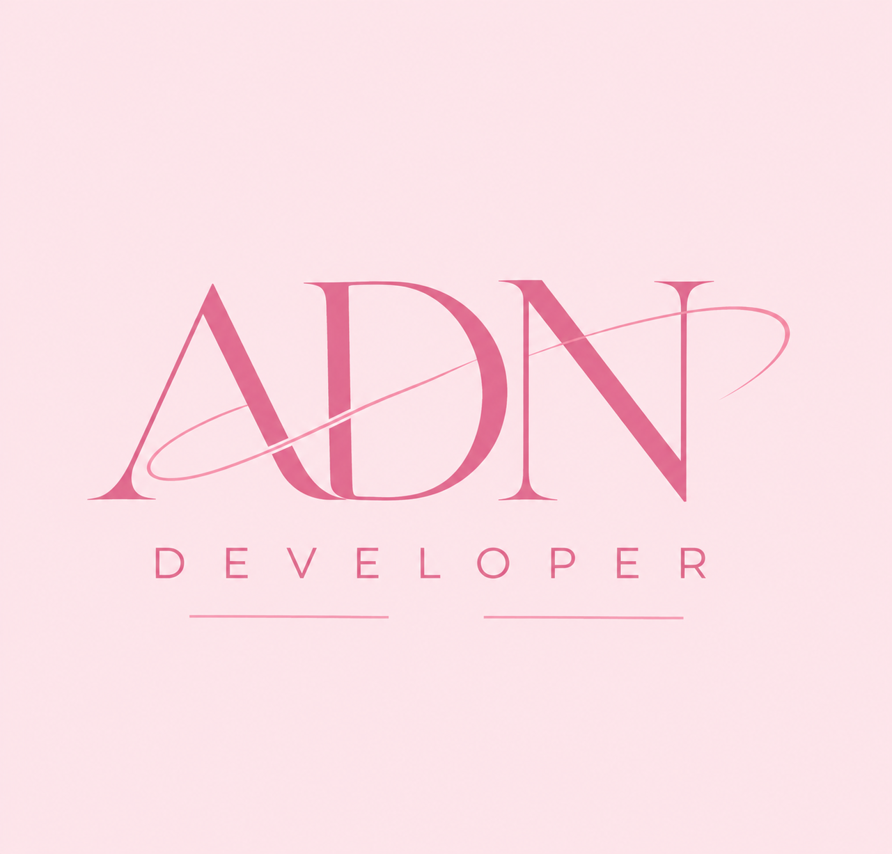

<<<<<<< HEAD
# Ana Disonisio | ADN Developer

Portfólio com animações. Arquivos: index.html, animations.css, animations.js, logo-adn.png (manter na mesma pasta).
=======
<div align="center">

  

  <h1>Ana Dionisio · ADN Developer</h1>

  <p>
    <strong>Portfólio oficial de Desenvolvimento Fullstack</strong><br />
    Sites estratégicos, rápidos e personalizados — do design ao código.
  </p>

  <p>
    
    
    
    
  </p>

  <p>
    <a href="#-sobre-o-projeto">Sobre</a> •
    <a href="#-destaques-e-funcionalidades">Funcionalidades</a> •
    <a href="#-projetos-em-destaque">Projetos</a> •
    <a href="#-estrutura-de-arquivos">Estrutura</a> •
    <a href="#-contato">Contato</a>
  </p>

</div>

---

## ✨ Sobre o Projeto

Este repositório contém o código-fonte do portfólio profissional da **ADN Developer**, marca da desenvolvedora fullstack **Ana Dionisio**. 

O projeto foi construído **sem dependências externas pesadas** (100% HTML, CSS e JavaScript puro), priorizando carregamento instantâneo, identidade visual autoral, microinterações fluidas em GPU e acessibilidade real para todos os perfis de usuários.

---

## 🚀 Destaques e Funcionalidades

- **🎨 Identidade Visual & Temas:** Suporte nativo a **Modo Claro** e **Modo Escuro** com persistência automática via `localStorage` e detecção de preferência do sistema.
- **♿ Painel de Acessibilidade Completo:**
  - Ajuste dinâmico de tamanho da fonte (`A`, `A+`, `A++`);
  - Modo de **Alto Contraste**;
  - Opção para **Reduzir Movimento** (respeitando também `prefers-reduced-motion`);
  - Sublinhado forçado em links e aumento de espaçamento de leitura.
- **⚡ Animações Otimizadas (60fps):**
  - Preloader animado e revelação progressiva de títulos palavra por palavra;
  - Partículas interativas em `<canvas>` com densidade adaptativa para mobile e desktop;
  - Efeito *Tilt 3D* com brilho radial nos cartões e botões magnéticos para dispositivos com mouse;
  - Efeito máquina de escrever (*typewriter*) e contadores numéricos animados.
- **📱 Responsividade Fluida:** Layout pensado para funcionar com proporção e conforto visual desde telas de smartphones (`360px`) até notebooks e monitores widescreen.
- **💬 Orçamento Inteligente com WhatsApp:** Formulário com validação em tempo real, pré-visualização da mensagem formatada e envio direto para o WhatsApp.

---

## 💼 Projetos em Destaque

### 🍨 Projeto Real no Ar: [Gela Gourmet](https://gelagourmet.com.br)
Sistema de pedidos online desenvolvido para loja de geladinhos gourmet atendendo **Tambaú** e **Santa Cruz das Palmeiras**:
- Cardápio digital com carrinho e cálculo automático de valores;
- Seleção de entrega (com taxa por cidade) ou retirada no local;
- Controle visual de sabores esgotados e acompanhamento do pedido;
- Finalização direta pelo WhatsApp sem necessidade de cadastro.

### 🖥️ Demonstrações Interativas (Modais)
O portfólio conta com **4 aplicações conceituais navegáveis** dentro da própria página:
1. **Brasa & Sal** *(Restaurante Contemporâneo)* — Cardápio filtrável, comanda em tempo real e reserva de mesa.
2. **Cadeira Doze** *(Barbearia Premium)* — Calculadora de serviços/duração e agenda de horários por profissional.
3. **Atelier Prumo** *(Escritório de Arquitetura)* — Galeria de obras com filtro por categoria e ficha técnica detalhada.
4. **Fluxa** *(Produto Digital / SaaS)* — Quadro Kanban interativo com movimentação de tarefas e simulador de planos por equipe.

---

## 📂 Estrutura de Arquivos

```text
adn_developer/
├── index.html        # Estrutura semântica, estilos base, seções e motor das demos
├── animations.css    # Camada de animações, transições, tilt 3D e efeitos visuais
├── animations.js     # Controle de partículas, preloader, contadores e interações
├── logo-adn.png      # Identidade visual ADN Developer
└── README.md         # Documentação do repositório
>>>>>>> 1643329f7a066487f5b5123bec1da73bfc36faa4
